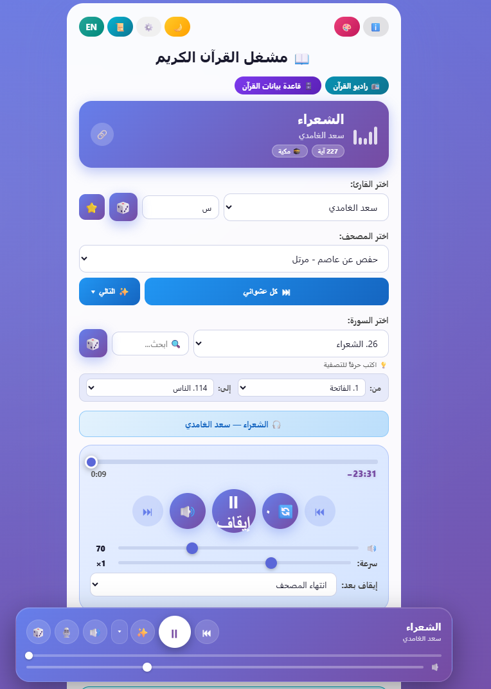
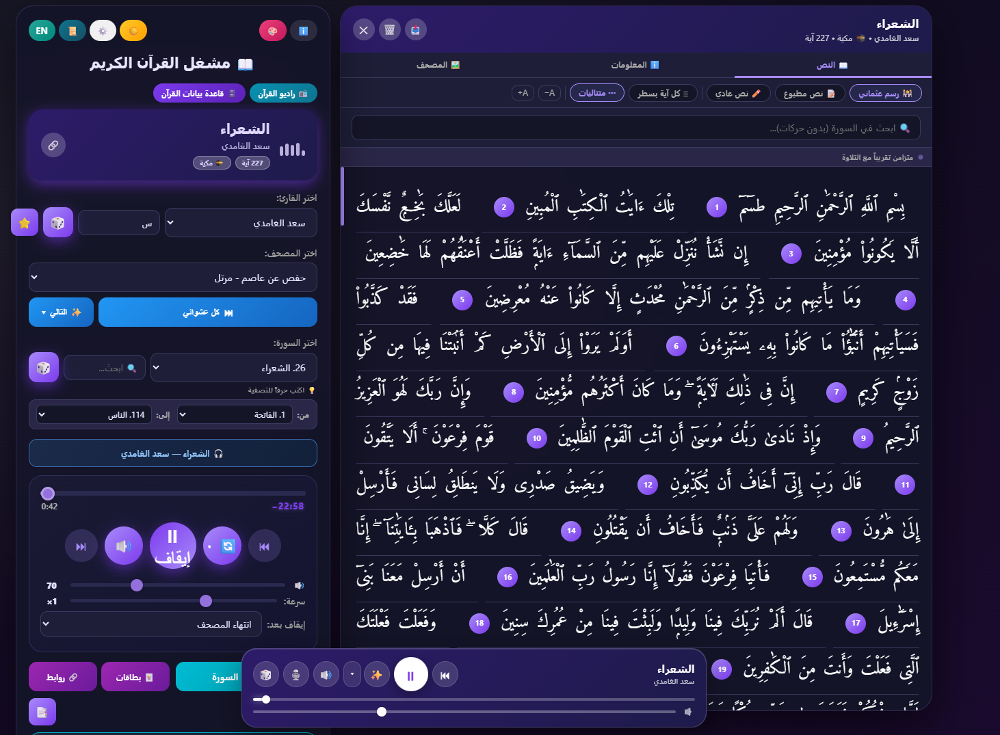
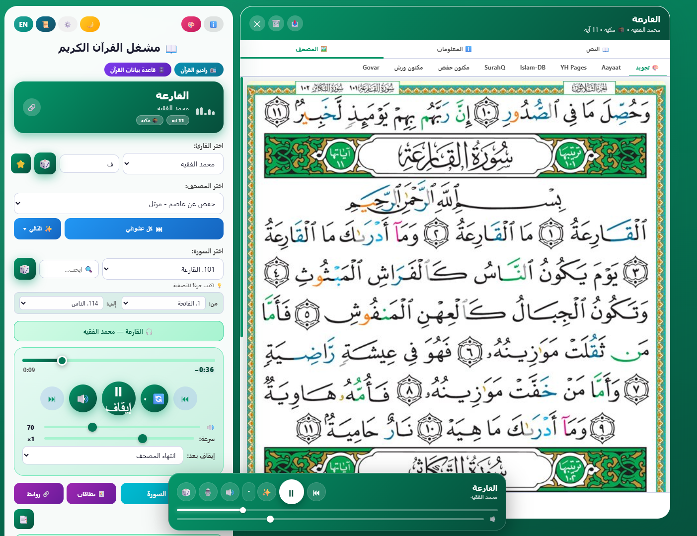
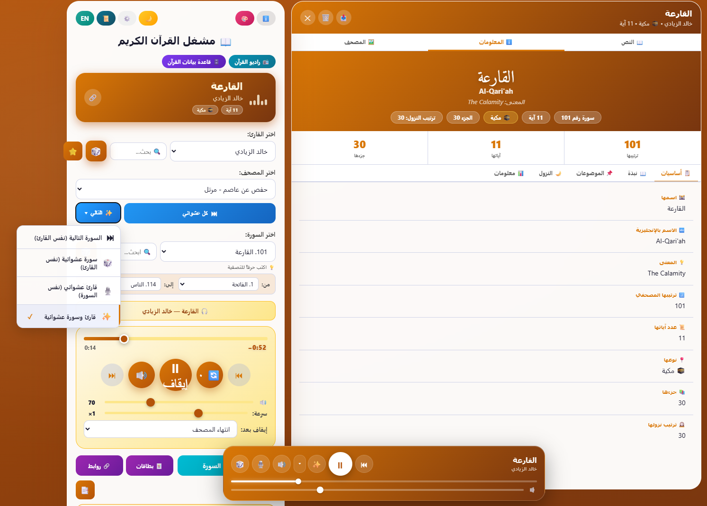

<div align="center">

# 📖 مشغل القرآن الكريم

### Quran Player — a bilingual, in-browser Quran audio & Mushaf player

مشغّل صوتي ومصحف تفاعلي للقرآن الكريم يعمل مباشرةً في المتصفح، يدعم اللغتين العربية والإنجليزية،<br/>
ومبني كتطبيق ويب تقدمي ثابت (Static PWA) مستضاف على GitHub Pages.

<br/>

<a href="https://alhlhli.github.io/Quran-Player/" target="_blank" rel="noopener noreferrer">
  
</a>
<a href="https://alhlhli.github.io/Quran-Player/" target="_blank" rel="noopener noreferrer">
  
</a>


🔗 **التطبيق:** <a href="https://alhlhli.github.io/Quran-Player/" target="_blank" rel="noopener noreferrer">alhlhli.github.io/Quran-Player</a>

</div>

---

## 📑 المحتويات

- [نبذة](#-نبذة)
- [المميزات](#-المميزات)
- [لقطات من التطبيق](#️-لقطات-من-التطبيق)
- [اختصارات لوحة المفاتيح](#️-اختصارات-لوحة-المفاتيح)
- [التقنيات المستخدمة](#️-التقنيات-المستخدمة)
- [جميع المصادر والواجهات البرمجية المعتمدة](#-جميع-المصادر-والواجهات-البرمجية-المعتمدة-apis--sources)
- [بنية المشروع](#-بنية-المشروع)
- [التشغيل محلياً](#-تشغيل-المشروع-محلياً)
- [المصمم](#-المصمم)
- [الترخيص](#-الترخيص)

---

## 🧭 نبذة

تطبيق صفحة واحدة (SPA) خفيف وسريع، بلا أي خادم خلفي وبلا مكتبات خارجية — كل شيء يعمل داخل المتصفح مباشرةً. صُمّم بواجهة عربية كاملة من اليمين لليسار (RTL)، مع دعم إنجليزي كامل، وتصميم متجاوب يعمل بكفاءة على الجوال والحاسب، وإمكانية تثبيته كتطبيق مستقل (PWA) على الشاشة الرئيسية.

> **النسخ السابقة (للأرشفة):**
> - <a href="https://alhlhli.github.io/Quran-Player/مشغل%20القرآن%20الكريم.html" target="_blank" rel="noopener noreferrer">مشغّل القرآن الكريم (النسخة الأولية)</a>
> - <a href="https://alhlhli.github.io/Quran-Player/مشغل_القرآن_v20.html" target="_blank" rel="noopener noreferrer">مشغّل القرآن الإصدار V2.0</a>

---

## ✨ المميزات

### 🎧 التشغيل والصوت
- 🎯 **مزامنة الآيات بالمللي ثانية (Precision Ayah Sync)** — نظام مطابقة صوتية لحظي دقيق لكبار القرّاء (مشاري العفاسي، الحصري، المنشاوي، عبد الباسط، السديس، الشريم، القطامي، الغامدي، العجمي، الشاطري، وغيرهم) يربط كل آية بتوقيتها القطعي بالمللي ثانية، مع إمكانية النقر على أي آية للانتقال إليها وتشغيلها فوراً.
- 🎙️ **قرّاء متعددون** — اختر من بين أكثر من ٢٥٠ قارئاً من كبار قرّاء القرآن الكريم مع مختلف الروايات والمصاحف.
- 📖 **مصاحف متعددة** — يُختار **المصحف الأول تلقائياً** فور اختيار القارئ لتبدأ الاستماع بنقرة واحدة، مع استكمال التلاوة من نفس الآية عند تبديل القارئ.
- 🔄 **أوضاع التكرار** — كرّر السورة مرة أو مرتين أو ثلاثاً، أو بلا نهاية، أو أوقف التكرار.
- 🔊 **التحكم في الصوت والسرعة** — شريط مستوى صوت قابل للضبط مع كتم سريع، وتغيير سرعة التلاوة من ٠.٥× حتى ٢×.
- ⏭️ **خيارات «التالي» الذكية** — السورة التالية، أو سورة عشوائية، أو قارئ عشوائي، أو الاثنان معاً.
- 🎚️ **شريط مشغّل عائم** — تحكّم سريع يظهر أثناء التصفح والقراءة.
- 🕌 **تهيئة ذكية حسب اليوم** — اختيار تلقائي لسورة الكهف يوم الجمعة، وسورة الفاتحة في باقي الأيام للمستخدمين الجدد.

### 📜 نص القرآن والمصحف وتجربة الجوال المطوّرة
- 🕋 **خط المصحف المعتمد (QCF V4)** — عرض الآيات بخطوط مجمع الملك فهد لطباعة المصحف الشريف (604 صفحات) مع تحميل خط كل صفحة عند الحاجة، وهو **الرسم الافتراضي** للتطبيق.
- 🎨 **خط التجويد الملوّن (Tajweed COLR/CPAL)** — تلوين أحكام التجويد (الغنّة، الإخفاء، القلقلة، التفخيم، والمدود) مع دليل تفاعلي للأحكام ودعم كامل للثيم الداكن.
- 📜 **خيارات متعددة للرسم والتخطيط** — الرسم العثماني، النص المطبوع، النص الإملائي البسيط، مع إمكانية العرض المتتالي أو كل آية في سطر مستقل، أو عرض الأسطر الـ 15 الحقيقية لكل صفحة مصحفية.
- 📱 **تجربة قراءة موسّعة ومخصّصة للجوال** — في عرض الجوال يتوسع محتوى نص المصحف ليملأ كامل عرض الشاشة مع تخفيف العناصر غير الضرورية، وتوفير **شريط اختيار مباشر للقارئ والسورة** أعلى النص، مع **زر الإعدادات ⚙️ وزر البحث المدمج 🔍** مباشرةً داخل شاشة النص.
- 🖼️ **المصحف المصوّر (10 مصادر)** — تصفح صفحات المصحف الشريف المصوّرة من 10 مصادر متنوعة (مصحف التجويد، الحفظ الميسر، حفص، ورش، وغيرها) مع تقليب تلقائي متزامن مع التلاوة.
- ℹ️ **بطاقة معلومات السورة** — إحصائيات السورة، معناها، ترتيب نزولها، نبذة عنها، موضوعاتها، مقاصدها، أسباب النزول، وفضلها.

### 🔗 نظام المشاركة المتقدم
- 🔗 **مشاركة التلاوة برابط عميق (Deep-Link)** — مشاركة رابط يفتح نفس القارئ والمصحف والسورة والآية الحالية مباشرةً لدى المستلم داخل التطبيق.
- 📖 **مشاركة نص الآية الحالية** — نسخ أو مشاركة نص الآية الجارية بالرسم العثماني مع اسم السورة ورقم الآية ورابط الاستماع.
- 🎵 **مشاركة ملف الصوت المباشر (MP3)** — مشاركة رابط الاستماع والتحميل المباشر لملف السورة الصوتي.
- 🌐 **مشاركة رابط التطبيق** — مع نسخ تلقائي فوري إلى الحافظة عند عدم توفر واجهة المشاركة الأصلية في المتصفح.

---

## 🖼️ لقطات من التطبيق

<div align="center">






</div>

---

## ⌨️ اختصارات لوحة المفاتيح

| المفتاح | الوظيفة |
| :--- | :--- |
| `Space` | تشغيل / إيقاف مؤقت |
| `→` | السورة التالية |
| `←` | السورة السابقة |
| `R` | تغيير وضع التكرار |
| `M` | كتم / إلغاء كتم الصوت |
| `T` | عرض / إخفاء نص السورة |
| `+` أو `=` | رفع مستوى الصوت |
| `-` أو `_` | خفض مستوى الصوت |
| `S` | البحث في السور |
| `Esc` | إغلاق النوافذ المنبثقة أو لوحة النص |

---

## 🛠️ التقنيات المستخدمة

- **HTML5** — بنية دلالية قياسية ووسم `<audio>` للتدفق الصوتي.
- **CSS3** — متغيّرات CSS، تصميم متجاوب (Responsive & Mobile-First Reading Mode)، دعم RTL/LTR، وسمات لونية متعدّدة.
- **JavaScript (ES6+ Vanilla)** — معمارية نظيفة بدون أي مكتبات أو أُطر خارجية.
- **Service Worker & Web App Manifest (PWA)** — تخزين ذكي متعدد الطبقات (`Stale-While-Revalidate` للتطبيق، `Network-First` للبيانات، و`Cache-First` للخطوط والصور).
- **FontFace API & CSS `@font-palette-values`** — لتحميل خطوط صفحات المصحف الـ 604 ديناميكياً وتبديل لوحات ألوان التجويد في الوضع الداكن.

---

## 🔌 جميع المصادر والواجهات البرمجية المعتمدة (APIs & Sources)

يعتمد المشروع على مجموعة متكاملة وموثوقة من الواجهات البرمجية المفتوحة ومستودعات الخطوط والمصاحف:

### 1. 🎙️ مصادر الصوتيات والقراء والتوقيت الزمني (Audio & Timings APIs)
| المصدر | الرابط / النطاق | الاستخدام في المشروع |
| :--- | :--- | :--- |
| **MP3Quran API v3** | `https://www.mp3quran.net/api/v3/reciters`<br/>`https://www.mp3quran.net/api/v3/suwar`<br/>`https://cdn.mp3quran.net/` | جلب قائمة القراء (+250 قارئاً)، الروايات والمصاحف، أسماء السور باللغتين، وروابط خوادم التلاوات الصوتية (بما فيها تلاوة الشيخ المنشاوي المجودة). |
| **Quran.com API v4** | `https://api.quran.com/api/v4/chapter_recitations/{id}/{surah}?segments=true` | جلب التلاوات الصوتية المتزامنة وجداول التوقيت الزمني للآيات بالمللي ثانية (`timestamps` & `segments`) لقرّاء المزامنة الدقيقة (🎯). |
| **QuranicAudio CDN** | `https://download.quranicaudio.com/` | الخادم الصوتي الرئيسي لتدفق وتحميل ملفات MP3 عالية الجودة الخاصة بواجهة Quran.com. |

### 2. 📜 مصادر نصوص القرآن الكريم ومعلومات السور (Text & Surah Info APIs)
| المصدر | الرابط / النطاق | الاستخدام في المشروع |
| :--- | :--- | :--- |
| **AlQuran Cloud API** | `https://api.alquran.cloud/v1/surah/{n}/quran-uthmani`<br/>`https://api.alquran.cloud/v1/surah/{n}` | جلب نص السورة بالرسم العثماني (`quran-uthmani`) وبالنص المطبوع القياسي. |
| **Quran.com Verses API** | `https://api.quran.com/api/v4/verses/by_chapter/{n}?fields=text_imlaei_simple` | جلب النص الإملائي البسيط (`text_imlaei_simple`) للعرض والبحث السريع بدون تشكيل. |
| **Quranpedia API** | `https://api.quranpedia.net/api/v1/surah/information/{n}`<br/>`https://quranpedia.net/surah/{n}` | جلب معلومات السورة التفصيلية (نبذة عن السورة، أسماؤها، موضوعاتها، مقاصدها، أسباب النزول، فضلها، القصص النبوية، وعدد كلماتها). |
| **AllOrigins Proxy** | `https://api.allorigins.win/get?url=` | وسيط CORS احتياطي لضمان استمرارية جلب النصوص والمعلومات عند وجود قيود شبكة. |

### 3. 🕋 مصادر خطوط المصحف الشريف والتجويد والخطوط العربية (Fonts & Glyph Data)
| المصدر | الرابط / المستودع | الاستخدام في المشروع |
| :--- | :--- | :--- |
| **خطوط مصحف المدينة (QCF V4)** | `m4hmoud-atef/qcf_quran`<br/>عبر `cdn.jsdelivr.net` و `raw.githubusercontent.com` | خطوط مجمع الملك فهد لطباعة المصحف الشريف (`QCF4001_X-Regular.woff` حتى `QCF4604_X-Regular.woff`) مع بيانات ترميز الآيات والصفحات المدمجة محلياً في `qcf-data.js`. |
| **خط التجويد الملوّن (QCF V4 Tajweed)** | `YaseenDotDev/quran-qcf-v4`<br/>عبر `cdn.jsdelivr.net` و `raw.githubusercontent.com` | خطوط المصحف الملوّنة بتقنية `COLR/CPAL` (`p1.ttf` حتى `p604.ttf`) لتلوين أحكام التجويد مع دعم تبديل الباليت في الوضع الداكن. |
| **Google Fonts** | `https://fonts.googleapis.com`<br/>`https://fonts.gstatic.com` | خط **Amiri Quran** وخط **Scheherazade New** لعرض الرسم العثماني والنص القرآني والبسملة وعناوين السور. |

### 4. 🖼️ مصادر صور صفحات المصحف الشريف العشرة (10 Mushaf Image Sources)
يوفر تبويب **«🖼️ المصحف»** 10 مصادر متنوعة لصور صفحات المصحف الشريف (من صفحة 1 إلى 604) مع انتقال احتياطي تلقائي (`Fallback`) عند تعذر أي مصدر:

| # | اسم المصدر في التطبيق | الرابط / المزوّد | الرواية / الميزة |
| :-: | :--- | :--- | :--- |
| 1 | **🎨 تجويد (الافتراضي)** | `https://www.islamicbook.ws/2/{p}.jpg` | مصحف التجويد الملوّن |
| 2 | **📗 الحفظ الميسر** | `https://newapi.hefzmoyaser.net/storage/mushaf_images/hafs/{p}.webp` | مصحف الحفظ الميسر برواية حفص (WebP) |
| 3 | **📗 الحفظ الميسر مع الملاحظات** | `https://newapi.hefzmoyaser.net/storage/mushaf_images/hafs_with_footnotes/{p}.webp` | مصحف الحفظ الميسر مع الهوامش والتفسير |
| 4 | **Aayaat (آيات)** | `https://cdn.aayaat.net/storage/outputs/image/HafsK_Page{p}.png` | مصحف المدينة برواية حفص بدقة عالية |
| 5 | **YH Pages (يوسف هيبة)** | `https://quran.yousefheiba.com/api/quran-pages/{p}.png` | صفحات مصحف المدينة النبوية |
| 6 | **Islam-DB** | `https://quran.islam-db.com/data/pages/quranpages_1024/images/page{p}.png` | صفحات المصحف الشريف بدقة `1024px` |
| 7 | **SurahQ (سورة قرآن)** | `https://surahquran.com/img/pages-quran/page{p}.png` | صفحات المصحف المصوّرة من موقع سورة قرآن |
| 8 | **مكنون حفص (`maknon/Quran`)** | `https://raw.githubusercontent.com/maknon/Quran/refs/heads/main/pages-hafs/{p}.png` | مصحف حفص عن عاصم من مستودع مكنون |
| 9 | **مكنون ورش (`maknon/Quran`)** | `https://raw.githubusercontent.com/maknon/Quran/refs/heads/main/pages-warsh/{p}.png` | مصحف رواية ورش عن نافع من مستودع مكنون |
| 10 | **Govar (`GovarJabbar/Quran-PNG`)** | `https://raw.githubusercontent.com/GovarJabbar/Quran-PNG/refs/heads/master/{p}.png` | صفحات المصحف بصيغة PNG عالية الوضوح |

### 5. 🔗 المشاريع الشقيقة المربوطة بالتطبيق
- **📻 راديو القرآن الكريم:** <a href="https://alhlhli.github.io/Quran-Radio/" target="_blank" rel="noopener noreferrer">alhlhli.github.io/Quran-Radio</a>
- **🗄️ قاعدة بيانات القرآن الكريم:** <a href="https://alhlhli.github.io/Quran-Database/" target="_blank" rel="noopener noreferrer">alhlhli.github.io/Quran-Database</a>

> جميع الحقوق للمصادر والواجهات البرمجية تعود لأصحابها، ويُستخدم المحتوى لأغراض الاستماع والتلاوة وخدمة كتاب الله الكريم.

---

## 📁 بنية المشروع

```text
Quran-Player/
├── README.md                # دليل تشغيل وتوثيق المشروع الشامل وكافة المصادر
├── index.html               # البنية الرئيسية للتطبيق ولوحة المصحف والنوافذ الحوارية
├── script.js                # محرك التشغيل، المزامنة الدقيقة، خطوط المصحف، والمشاركة
├── style.css                # نظام التصميم والسمات وتخصيصات العرض الموسّع للجوال
├── qcf-data.js              # بيانات الآيات بترميز خطوط المصحف + خريطة الصفحات الـ 604
├── manifest.json            # تعريف تطبيق الويب التقدمي (PWA) والاختصارات
├── sw.js                    # Service Worker — إدارة الكاش والعمل دون اتصال (v24)
├── icon.svg                 # شعار التطبيق المتجهي (SVG)
└── icon.png                 # أيقونة التطبيق النقطية عالية الدقة (512×512)
```

---

## 🚀 تشغيل المشروع محلياً

لا يحتاج المشروع إلى أي تبعيات خارجية أو خطوة بناء:

- **الطريقة الأبسط:** افتح `index.html` مباشرة في المتصفح (تعمل جميع الميزات بما فيها بيانات `qcf-data.js` المدمجة).
- **الطريقة الكاملة (لتفعيل PWA وService Worker):** شغّل خادماً محلياً بسيطاً ثم افتح `http://localhost:8000`:

```bash
python3 -m http.server 8000
```

> **ملاحظة:** عند تحديث الملفات المنشورة، ارفع رقم `VERSION` في `sw.js` ليُحدَّث الكاش تلقائياً لدى الزوار.

---

## 👤 المصمم

<div align="center">

**م/ عامر الحلحلي**

[](https://t.me/pro3mer)
[](https://github.com/Alhlhli)

</div>

---

## 📄 الترخيص

هذا المشروع مفتوح المصدر. يُرجى مراجعة ملف [`LICENSE`](LICENSE) للاطلاع على التفاصيل.

---

<div align="center">

اللهم اجعله علماً نافعاً وصدقةً جارية 🤲

<sub>صُنع بعناية — م/ عامر الحلحلي · AL3MER</sub>

</div>
